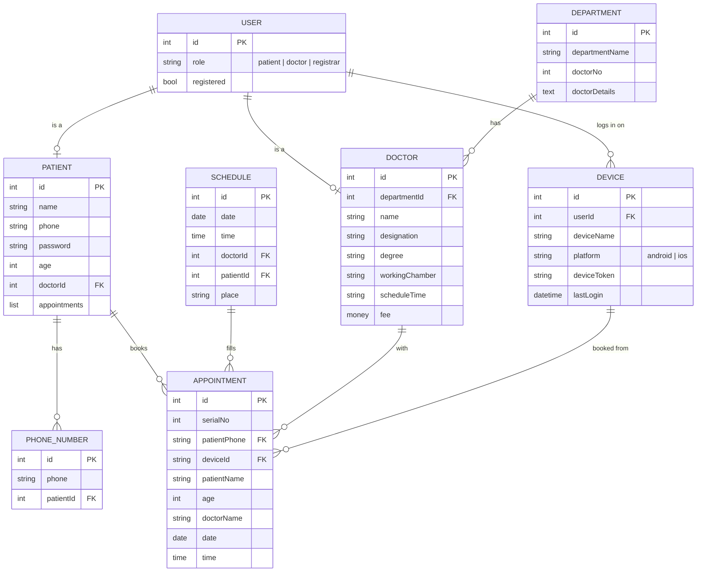

# ER Diagram

Data model for the Doctor Appointment app, redrawn from the notebook sketch with a Device table added.
A styled version with notes is in [er-diagram.html](er-diagram.html) (open it in a browser).

## How the app stores it

Each table is a table in Supabase, created by [supabase/schema.sql](../supabase/schema.sql). The project URL and anon key are in `.env`. The table code is in [src/services/database.js](../src/services/database.js) (read/write), [src/services/supabase.js](../src/services/supabase.js) (client) and [src/services/schema.js](../src/services/schema.js) (columns, seed and first-run migration).

- **Reads** come from Supabase and are also cached on the phone in AsyncStorage (`@doctor_app_db_v2_<table>`). If Supabase can't be reached, the cached copy is shown.
- **Writes** go to Supabase first. If Supabase refuses one, the app reports an error and doesn't save it only on the phone.
- **Seeding:** the first phone to connect to an empty project uploads its tables: the bundled doctors and sample appointments, plus anything saved on that phone.
- **Without `.env`,** the app works from phone storage only.

| Table | Key suffix | Service | Notes |
|---|---|---|---|
| USER | `users` | authStorage | `role` is `patient`, `doctor` or `registrar`. `registered` is false until the person signs up. |
| PATIENT | `patients` | authStorage | Shares its `id` with its USER row ("is a"). |
| PHONE_NUMBER | `phoneNumbers` | authStorage | Phone lookups go through this table. |
| DEVICE | `devices` | devicesStorage | Written on Get Started, sign up and log in. `deviceToken` stays empty until push notifications exist. |
| DEPARTMENT | `departments` | doctorsStorage | `doctorNo` is recounted on load. Also keeps `icon`, `color` and descriptions for the UI. |
| DOCTOR | `doctors` | doctorsStorage | Shares its `id` with its USER row. Fields are stored in both languages, for example `nameBn`/`nameEn`. |
| SCHEDULE | `schedules` | appointmentsStorage | One row per booking, with `place` set to the doctor's chamber. |
| APPOINTMENT | `appointments` | appointmentsStorage | Saved against the login phone (`patientPhone`) and the device it was booked on (`deviceId`). Also stores `doctorId`, `patientId`, `scheduleId`, `fee`, `status` and `createdAt`. `serialNo` counts up per doctor per day. My Appointments lists rows by phone number. |

Field names in code for the DOCTOR columns: `degree` → `degreesBn/En`, `workingChamber` → `chamberBn/En`, `scheduleTime` → `availableBn/En`, `fee` → `feeBn/En`.

The screens still receive departments with their doctors nested inside, and appointments with the doctor's name, image, department and chamber filled in. These are joined from the tables when loaded, so editing a doctor also updates their existing appointments.

On the first run after this change, data saved by the old version (`@doctor_app_users_v1`, `@doctor_app_custom_departments_v1`, `@doctor_app_appointments_v1`) is copied into the new tables. The old keys are left in place.

## Notes

- **User** is the shared login. Patient, Doctor and the registrar are each a kind of user.
- **Device** records each phone a user signs in from. One user can have many devices.
- **Phone Number** is a separate table, so one patient can keep several numbers.
- Not in the original sketch: the `id` on Schedule, Appointment, Doctor and Department, `departmentId` on Doctor, and the whole Device table.
- The fifth Patient field was read from the sketch as `doctorId`.
